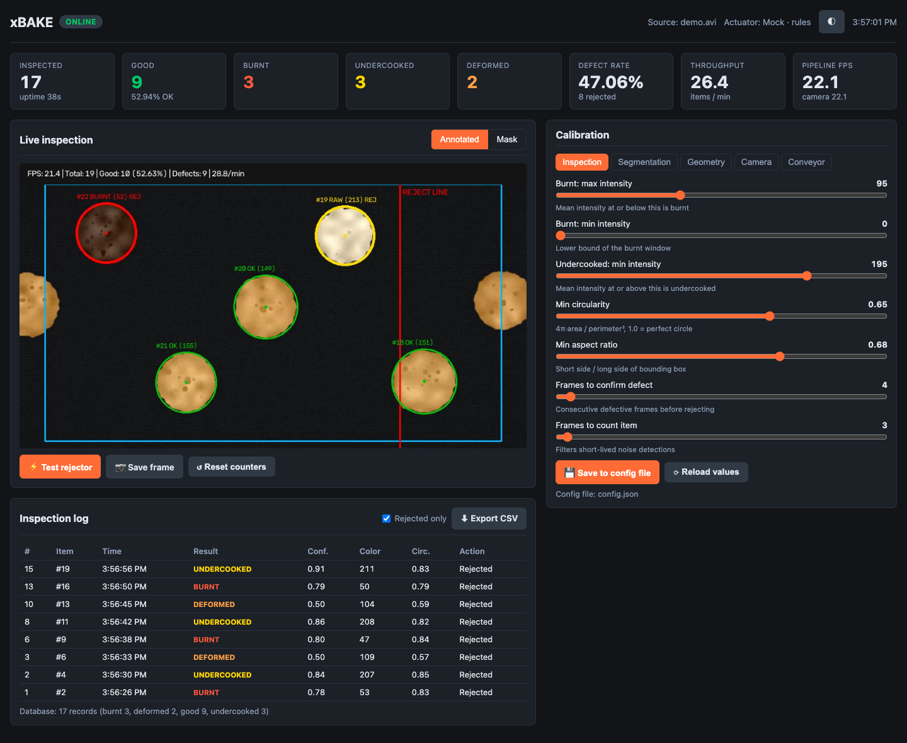
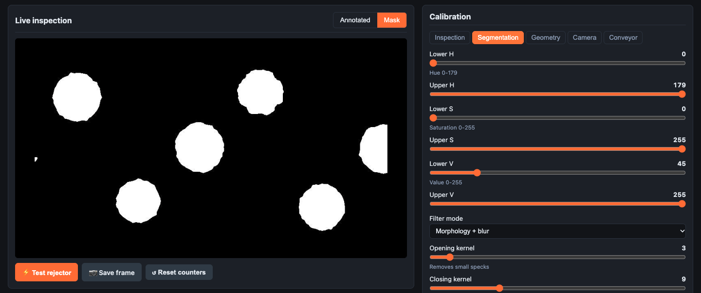
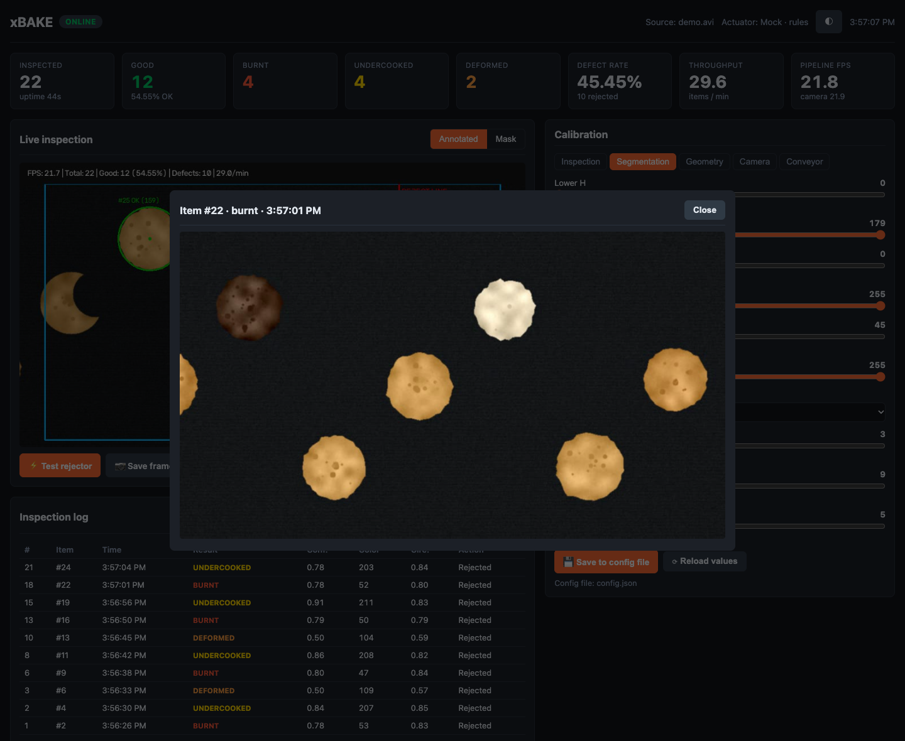
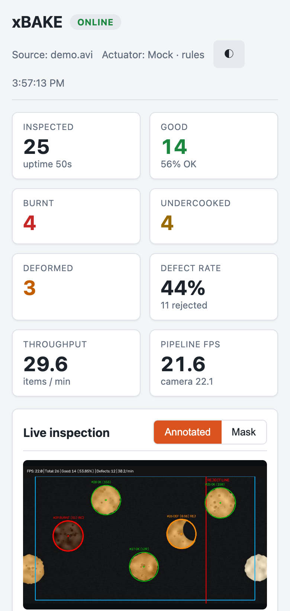

# xBAKE

**Open-source computer vision quality control for bakery conveyor lines.**

<p align="center">
  
</p>

xBAKE watches products on a conveyor belt through a camera, classifies each one as
**good**, **burnt**, **undercooked**, or **deformed**, fires a rejector (relay, pneumatic
valve, or robotic arm) when a defect is confirmed, and records every inspection in a local
SQLite database you can export for analysis and research.

It targets round, flat baked goods (flatbreads, buns, biscuits, pizza bases), runs on a
Raspberry Pi or any Linux/macOS/Windows machine, and includes a browser dashboard for live
monitoring and calibration.

The default computer-vision baseline is deliberately transparent and reproducible:
OpenCV HSV segmentation, geometry features, and rule-based classification. ONNX is
optional for users who want to provide a compatible custom classifier; it is not required
for the baseline or the synthetic demo.

**Python 3.10+** · **MIT License** · Raspberry Pi, Linux, macOS, Windows



<sub>Screenshots show xBAKE processing the synthetic demo clip from
[`tools/make_demo_video.py`](tools/make_demo_video.py), not a real production line.</sub>

---

## Contents

- [Features](#features)
- [Screenshots](#screenshots)
- [How it works](#how-it-works)
- [Installation](#installation)
- [Quick start](#quick-start)
- [Command line](#command-line)
- [Web dashboard](#web-dashboard)
- [GitHub Pages demo](#github-pages-demo)
- [HTTP API](#http-api)
- [Configuration](#configuration)
- [Data for research](#data-for-research)
- [Hardware](#hardware)
- [Deployment](#deployment)
- [Development](#development)
- [License](#license)

---

## Features

- **Rule-based defect classification** that works without training data:
  - *Burnt*: mean crust intensity inside a configurable dark window.
  - *Undercooked*: mean intensity above a pale threshold.
  - *Deformed*: circularity `4π·area / perimeter²` and aspect ratio below thresholds.
- **Optional ONNX classifier** – drop in your own model to replace the rules.
- **Multi-object tracking** across frames, so each product is judged once and a defect must
  persist for *N* consecutive frames before it is rejected (filters flicker and noise).
- **Conveyor-synchronized rejection** – the pulse is delayed by the time the item needs to
  travel from where it was detected to the rejector line.
- **Hardware abstraction** – Raspberry Pi GPIO relay, serial G-code robotic arm, or a mock
  actuator for development without hardware.
- **Web dashboard** (no external dependencies) with live annotated and mask video, KPIs,
  calibration sliders, rejector test, inspection log with defect snapshots, and CSV export.
- **Local-first storage** – every inspected item (passed and rejected) goes to SQLite;
  optional background mirroring to Google Sheets.
- **Offline benchmarking** on recorded video.

## Screenshots

**Calibration.** Switch the stream to *Mask* and tune the HSV range and morphology until every
product is a solid white blob and the belt is black. Changes apply to the running pipeline
immediately.



**Defect snapshots.** Every rejected item is saved as a full, unannotated frame. Click a
rejected row in the inspection log to review it.



<p align="center">
  
  <br><sub>The dashboard also works on phones and follows the system light/dark theme.</sub>
</p>

## How it works

```
 Camera / video file
        │
        ▼
 CameraStream ─── threaded capture, reconnect, native-rate file playback
        │
        ▼
 ItemDetector ─── ROI crop → HSV threshold → morphology/blur → contours
        │           → radius filter → circularity, aspect ratio, mean intensity
        ▼
 ItemClassifier ─ rules (or ONNX model) → good / burnt / undercooked / deformed
        │
        ▼
 CentroidTracker ─ matches detections across frames, closes tracks that leave the view
        │
        ├──► ConveyorRejector ─ travel-time delay → GPIO relay / robotic arm / mock
        ├──► Database ───────── SQLite record per item + periodic telemetry
        └──► Web dashboard ──── MJPEG stream, JSON API, CSV export
```

An item's final verdict is recorded once: when it is **rejected** (defect confirmed for
`min_frames_to_reject` consecutive frames), or when it **leaves the field of view** as
passed (seen for at least `min_frames_to_count` frames).

## Installation

Requires Python 3.10 or newer.

```bash
git clone https://github.com/KOKUTBON/xBAKE.git
cd xBAKE
python3 -m venv .venv
source .venv/bin/activate          # Windows: .venv\Scripts\activate
pip install -e .
```

Optional extras:

| Extra | Installs | Needed for |
| :--- | :--- | :--- |
| `hardware` | `gpiozero`, `pyserial` | Raspberry Pi relay, serial robotic arm |
| `cloud` | `gspread`, `google-auth` | Google Sheets sync |
| `ai` | `onnxruntime` | ONNX classifier |
| `dev` | `pytest`, `ruff` | Running tests and linting |

```bash
pip install -e ".[hardware,cloud]"   # or ".[all]"
```

## Quick start

1. Create a configuration file:

   ```bash
   xbake init-config            # writes ./config.json with defaults
   ```

2. Start the inspection engine with a USB camera (index `0`) or any video file:

   ```bash
   xbake run --source 0
   xbake run --source path/to/conveyor.mp4 --mock-hardware
   ```

3. Open **http://localhost:8000** and calibrate:
   - Switch the stream to **Mask** and adjust the **Segmentation** HSV sliders until each
     product is a solid white blob and the belt is black.
   - Adjust **Geometry** (radius range, ROI) so every product is circled.
   - Tune **Inspection** thresholds against known good and defective samples.
   - Click **Save to config file**.

Video files loop by default (`--no-loop` stops at the end).

### Try it without a camera

Generate the synthetic demo clip (40 flatbreads: 24 good, 6 burnt, 6 undercooked,
4 deformed) together with a matching configuration, then run it:

```bash
python tools/make_demo_video.py demo/
xbake run -c demo/config.json --no-loop     # open http://localhost:8000
```

To try your own products, record a short clip of them on a contrasting, matte belt and pass
it with `--source`.

## Command line

```
xbake run          [-c CONFIG] [-s SOURCE] [--host HOST] [-p PORT]
                   [--gui] [--no-web] [--no-loop] [--mock-hardware]
xbake benchmark    VIDEO [-c CONFIG] [--max-frames N] [--db PATH] [--save-snapshots]
xbake export       [-o OUTPUT.csv] [-c CONFIG] [--db PATH]
xbake init-config  [-o config.json] [--force]
xbake --version
```

- `run` is the default command. `--gui` opens a local OpenCV window (press `q` to quit).
- `benchmark` processes every frame of a video as fast as possible with a mock actuator and
  prints throughput and defect counts. Use `--db` to keep the per-item records.
- `export` writes all inspection records as CSV (`-o -` for stdout).

Example benchmark on the demo clip (desktop CPU; numbers depend on hardware and resolution):

```
$ xbake benchmark demo/demo.avi -c demo/config.json
==================================================
BENCHMARK RESULTS
==================================================
Video                  : demo/demo.avi
Frames processed       : 1782
Elapsed time           : 3.71s
Average pipeline FPS   : 480.6
Mean frame latency     : 2.08 ms
Items inspected        : 40
Good                   : 24
Burnt                  : 6
Undercooked            : 6
Deformed               : 4
Defect rate            : 40.0%
==================================================
```

The benchmark records verdicts but never schedules rejector pulses, since frames are
processed faster than real time.

`python -m xbake` works the same as `xbake`.

## Web dashboard

The dashboard is served at `http://<host>:<port>/` (default `127.0.0.1:8000`).

| Area | What it does |
| :--- | :--- |
| Header | Connection status, video source, actuator type, classifier mode, theme toggle |
| KPIs | Inspected, good, burnt, undercooked, deformed, defect rate, throughput, FPS |
| Live inspection | Annotated or binary-mask stream, save current frame, test rejector, reset counters |
| Inspection log | Latest records (rejected only or all), click a rejected row to view its snapshot, CSV export |
| Calibration | Inspection thresholds, HSV segmentation, geometry/ROI, camera properties, conveyor timing; changes apply live, **Save** writes them to the config file |

By default the server listens on `127.0.0.1` only. To reach it from other devices use
`--host 0.0.0.0` **and** set an access token (see [Security](#security)).

## GitHub Pages demo

A standalone interactive dashboard is available in [`site/`](site/). It runs entirely
in the browser with a synthetic conveyor, sample inspection history, batch scenarios,
calibration controls, product details, CSV exports, and light/dark themes.

Preview it locally without installing xBAKE:

```bash
python3 -m http.server 4173 --bind 127.0.0.1 --directory site
```

Open **http://127.0.0.1:4173/**. All data and controls are simulated; there is no camera,
production database, or hardware connection.

The GitHub Pages workflow is **manual only** and does not publish on push or merge.
See [the preview and publishing guide](docs/github-pages-demo.md) for deployment
steps, demo behavior, and validation commands.

---

## HTTP API

| Method | Path | Description |
| :--- | :--- | :--- |
| `GET` | `/` | Dashboard |
| `GET` | `/stream?view=annotated\|mask` | MJPEG stream |
| `GET` | `/frame.jpg?view=annotated\|mask` | Latest frame as JPEG |
| `GET` | `/api/status` | Version, camera, actuator, classifier, auth requirement |
| `GET` | `/api/metrics` | Live session counters |
| `GET` | `/api/config` | Current configuration (secrets masked) and the tunable parameter schema |
| `GET` | `/api/recent?limit=20&defects=1` | Latest inspection records |
| `GET` | `/api/summary` | Totals per defect type across the database |
| `GET` | `/api/export.csv?since=&until=` | CSV export (Unix timestamps) |
| `GET` | `/api/snapshot/<record id>` | Snapshot image of a rejected item |
| `POST` | `/api/config` | Apply tunable values, e.g. `{"inspection": {"M_color": 90}}` |
| `POST` | `/api/config/save` | Persist the running configuration |
| `POST` | `/api/rejector/test` | Fire one rejector pulse |
| `POST` | `/api/metrics/reset` | Reset live counters (database is untouched) |

`POST /api/config` validates every value (type and range) and applies all of them or none.
Only the parameters listed under `tunable` in `GET /api/config` can be changed at runtime.

## Configuration

Settings live in `config.json` (path from `--config`, `XBAKE_CONFIG`, or the current
directory). [`config.example.json`](config.example.json) lists every option with its
default. Unknown keys are ignored with a warning.

Key parameters:

| Section | Key | Default | Meaning |
| :--- | :--- | :--- | :--- |
| `camera` | `source` | `0` | Camera index, video file, or stream URL |
| `vision` | `lower_hsv` / `upper_hsv` | `[0,0,0]` / `[179,255,255]` | HSV range that selects products |
| `vision` | `filter_mode` | `0` | `0` morphology + blur, `1` morphology, `2` blur |
| `vision` | `min_radius` / `max_radius` | `30` / `120` | Radius bounds on a 0–400 scale of ROI height |
| `vision` | `roi_x/y/w/h` | `0,0,400,400` | Region of interest on a 0–400 scale of the frame |
| `inspection` | `m_color` / `M_color` | `0` / `95` | Mean intensity window classified as burnt |
| `inspection` | `undercooked_min_color` | `195` | Mean intensity at or above which items are undercooked |
| `inspection` | `min_circularity` / `min_aspect_ratio` | `0.65` / `0.68` | Shape limits for deformed items |
| `inspection` | `min_frames_to_reject` | `5` | Consecutive defective frames before rejecting |
| `inspection` | `onnx_model_path` | `""` | Optional ONNX classifier |
| `hardware` | `enabled` / `driver` | `false` / `mock` | Physical outputs are opt-in; use `rpi_gpio` or `robotic_arm` only with `enabled: true` |
| `hardware` | `conveyor_speed_px_per_s` | `80` | Belt speed used to delay the pulse (`0` = fire immediately) |
| `hardware` | `rejector_trigger_line_x` | `320` | Pixel column where the rejector acts |
| `storage` | `db_path` / `snapshot_dir` | `data/xbake.db` / `data/snapshots` | Local data locations |
| `storage` | `enable_cloud_sync` | `false` | Mirror records to Google Sheets |
| `web` | `host` / `port` | `127.0.0.1` / `8000` | Dashboard bind address |
| `web` | `auth_token` | `""` | Token required for control endpoints |

Environment variables: `XBAKE_CONFIG` (config path), `XBAKE_WEB_TOKEN` (access token; never
written to disk). See [`.env.example`](.env.example) for a template.

## Data for research

Everything xBAKE observes stays on the device in open formats, so it can be used to build
datasets, compare algorithms, or train models.

**SQLite database** (`data/xbake.db`), table `inspections` – one row per product:

| Column | Description |
| :--- | :--- |
| `item_id` | Track id within a session |
| `timestamp` | Unix time the verdict was recorded |
| `defect_type` | `good`, `burnt`, `undercooked`, `deformed` (last classification) |
| `confidence` | Classifier confidence 0–1 |
| `avg_color` | Mean BGR intensity of the item's central crop (0–255) |
| `circularity`, `aspect_ratio`, `radius_px` | Shape features from the last frame |
| `frames_seen`, `first_seen_ts`, `last_seen_ts` | Track statistics |
| `rejected` | `1` if the rejector fired for this item |
| `snapshot_path` | Full-frame JPEG saved at rejection time |
| `session_id` | Identifies one run of `xbake run` |

Table `telemetry_snapshots` stores session counters every `telemetry_interval_seconds`.

**Snapshots**: `data/snapshots/YYYY-MM-DD/HHMMSS_id<item>_<defect>.jpg` – the raw
(unannotated) frame at the moment of rejection.

**Export**: `xbake export -o inspections.csv` or the dashboard's *Export CSV* button.

**Custom ONNX models**: set `inspection.onnx_model_path`. The model receives the item's
central crop as a `1×3×224×224` float32 RGB tensor scaled to 0–1 and must output four logits
in the order `good, burnt, undercooked, deformed`.

No datasets or real recordings are shipped with this repository; the images in
`docs/images/` are screenshots of the synthetic demo.

## Hardware

### Safety first

The default configuration is safe for development: `hardware.enabled` is `false` and
`hardware.driver` is `mock`, so no GPIO pin, serial port, relay, valve, pusher, or robot
can be energized accidentally. The synthetic demo, tests, benchmark, and dashboard
rejector test all use `MockActuator` by default.

To connect real equipment, review the wiring and emergency-stop requirements, then make an
intentional configuration change with both `hardware.enabled: true` and an explicit
hardware driver (`rpi_gpio` or `robotic_arm`). Start with the actuator disconnected and
verify conveyor timing, authentication, and the rejector test procedure before applying
power. Never treat this project as a substitute for a machine-safety assessment.

A typical single-lane setup:

| Component | Example |
| :--- | :--- |
| Compute | Raspberry Pi 4/5 or any Linux mini PC |
| Camera | USB camera mounted above the belt, fixed exposure, diffuse lighting |
| Belt | Matte, contrasting color (black or blue) for clean segmentation |
| Actuator | Optocoupled relay module driving a solenoid valve, pusher, or diverter |

Relay wiring for the default `gpio_pin: 21` (BCM numbering):

```
 Raspberry Pi header          Relay module
 Pin 2  (5V)   ─────────────► VCC
 Pin 6  (GND)  ─────────────► GND
 Pin 40 (GPIO21) ───────────► IN1

 Relay COM ◄── actuator supply +      Relay NO ──► actuator +
```

Power the actuator from its own supply; never drive coils directly from the Pi.

For a robotic arm, set `hardware.driver` to `robotic_arm`, `arm_port`, and `arm_baudrate`.
The driver sends G-code (`G0`, `G28`, `M3`/`M5` for the gripper) over serial; adapt
`src/xbake/hardware/robotic_arm.py` to your firmware.

## Deployment

**Docker**

```bash
docker compose up -d --build
```

The compose file mounts `./data`, `./config`, and `./secrets`, passes `/dev/video0`, and
reads `XBAKE_WEB_TOKEN` from your environment. Uncomment the GPIO section on a Raspberry Pi.

**systemd**

```bash
sudo useradd --system --home /opt/xbake xbake
sudo git clone https://github.com/KOKUTBON/xBAKE.git /opt/xbake
sudo python3 -m venv /opt/xbake/.venv
sudo /opt/xbake/.venv/bin/pip install "/opt/xbake[hardware]"
sudo chown -R xbake:xbake /opt/xbake
sudo cp /opt/xbake/deploy/xbake.service /etc/systemd/system/
sudo systemctl daemon-reload && sudo systemctl enable --now xbake
```

Put `XBAKE_WEB_TOKEN=...` in `/etc/xbake/xbake.env` to protect the dashboard.

**Google Sheets sync (optional)**: create a Google Cloud service account, share the target
spreadsheet with its email, save the key as `secrets/google-service-account.json`, and set
`storage.enable_cloud_sync` to `true`. Records stay in SQLite until the upload succeeds.

### Security

- The dashboard binds to `127.0.0.1` by default. When exposing it, set `web.auth_token` or
  `XBAKE_WEB_TOKEN`; all `POST` endpoints then require `Authorization: Bearer <token>`.
  Read-only endpoints (stream, metrics, log, export) stay open, so keep the device on a
  trusted network or behind a reverse proxy with TLS and authentication.
- Keep credentials in `secrets/` (git-ignored). Never commit `config.json` with a token.

See [SECURITY.md](SECURITY.md) for reporting vulnerabilities.

## Development

```bash
pip install -e ".[dev]"
pytest -q
ruff check src tests tools
ruff format --check src tests tools
```

Tests generate synthetic conveyor footage at runtime and need no camera or hardware.
Contributions are welcome – see [CONTRIBUTING.md](CONTRIBUTING.md) and the
[Code of Conduct](CODE_OF_CONDUCT.md).

```
src/xbake/
├── cli.py             command line entry point
├── config.py          configuration schema, validation, persistence
├── models.py          domain models and metrics
├── vision/            camera, detector, classifier, tracker, pipeline
├── hardware/          actuator interfaces, GPIO, robotic arm, mock, rejector timing
├── storage/           SQLite database, Google Sheets sync
└── web/               HTTP server and dashboard template
tools/make_demo_video.py   synthetic conveyor clip for demos and screenshots
docs/images/               README screenshots
```

## License

[MIT](LICENSE) © Rei Doda

## KOKUTBON community and support

Open technology for the benefit of humankind — built by people, for people, and freely reusable by everyone.

Read [Contributing](CONTRIBUTING.md), [Code of Conduct](CODE_OF_CONDUCT.md), [Support](SUPPORT.md), [Governance](GOVERNANCE.md) and [Security](SECURITY.md). Help sustain the work through [GitHub Sponsors and other contributions](SPONSORSHIP.md). Maintainer release requirements are documented in [Release checklist](RELEASE_CHECKLIST.md).

## Source publication

See [source publication status](SOURCE_PUBLICATION.md) and [local validation record](PUBLICATION_VALIDATION.md) for the initial distribution and remaining release checks.
