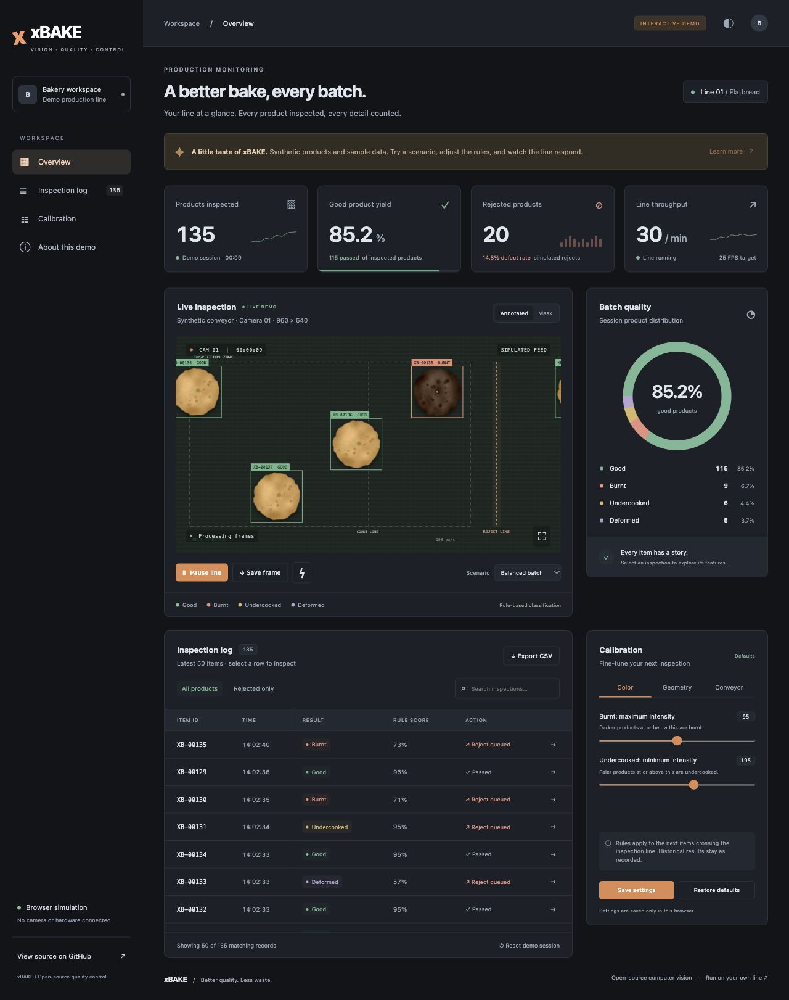

# GitHub Pages dashboard demo

The standalone xBAKE demo lives in `site/`. It is a plain HTML, CSS, and JavaScript
site with local assets, no build step, and no runtime dependencies. The Python
application and its live dashboard are separate and retain their existing behavior.



## Preview locally

From the repository root:

```sh
python3 -m http.server 4173 --bind 127.0.0.1 --directory site
```

Open <http://127.0.0.1:4173/>. Stop the server with Ctrl+C. You can also open
`site/index.html` directly; serving over HTTP is recommended for consistent
browser downloads and local storage behavior.

## What visitors can try

- A moving synthetic conveyor with annotated and mask views.
- Four batch scenarios: balanced, overbaked, underbaked, and shape defects.
- Pause/resume, a simulated rejector pulse, fullscreen, and PNG frame downloads.
- Consistent session metrics, product distribution, searchable inspection records,
  defect filtering, and product detail dialogs.
- Color and geometry rules that affect future inspections, belt speed, and pulse duration.
- Browser-local saved calibration and light/dark theme (charcoal by default).
- CSV export of all retained sample records, independent of the table filter.
- Session reset (clears the sample history; preserves current calibration and scenario).

The demo starts with 128 deterministic example records (112 good, 7 burnt,
5 undercooked, 4 deformed). New products are measured and classified in a
JavaScript simulation at the count line. Geometry takes priority over color,
matching the order of the Python baseline. Measurements and scores are illustrative;
they are not production results or validated ML accuracy. The mask view is a schematic
silhouette visualization, not a real HSV segmentation pipeline. Sprites were generated
from the repository's `tools/make_demo_video.py` with seed 7.

The browser retains at most 2,000 recent records in memory while counters continue
for the entire session. CSV includes those retained records with UTC ISO timestamps.
Calibration changes do not rewrite history. Reloading starts a new seeded session;
only explicitly saved calibration and the chosen theme persist in local storage.
There are no camera permissions, backend calls, analytics, external fonts, or hardware
connections. Reduced-motion users start with the line paused and can resume manually.

## Publish when you are ready

Nothing has been published by preparing these files. The publishing workflow is
**manual only**: there is no push, pull request, or scheduled deployment trigger.
The separate demo-checks workflow only runs syntax checks and tests.

1. Review and commit these files, then push them to the repository's default branch.
   GitHub requires a manually runnable workflow to exist on that branch.
2. In the GitHub repository, go to **Settings → Pages → Build and deployment**.
   Set **Source** to **GitHub Actions**.
3. Go to **Actions → Publish dashboard demo (manual) → Run workflow**.
   Choose the default branch (currently `main`) and run it when ready to publish.
4. The `github-pages` deployment environment and workflow summary will show the exact URL.

For the current origin, `https://github.com/KOKUTBON/xBAKE`, the expected default
project URL is **https://kokutbon.github.io/xBAKE/**. Preserve the repository's casing;
`/xBake/` is a different URL. If the repository is renamed, GitHub supplies the new
URL. All demo asset paths are relative, so repository subpaths need no rebuild or
base-path changes. Only the contents of `site/` are uploaded, not configuration,
source code, database files, or local secrets.

Keep the repository private. GitHub Pages from a private personal repository requires
GitHub Pro; GitHub Team applies to organization-owned repositories. For a personal
site at **https://kokutbon.github.io/**, the publishing repository must be named
`kokutbon.github.io`. This repository remains `xBAKE` until you choose to rename it
or create a separate personal-site repository. The published Pages website is public
even when its source repository is private.

The workflow uses GitHub's official Pages actions. See
[Using custom workflows with GitHub Pages](https://docs.github.com/en/pages/getting-started-with-github-pages/using-custom-workflows-with-github-pages).

## Validate the simulation

Use Node.js 24 (the workflow's version) or a supported Node version with `node:test`:

```sh
node --check site/engine.js
node --check site/app.js
node --test tests/demo.test.cjs
```

The tests cover sample count consistency, pause/resume and single counting,
classification precedence, calibration behavior, scenario mix, throughput, reset,
saved-setting validation, CSV contents, and bounded history. Browser QA should also
cover desktop/mobile layout, mask switching, dialogs, storage persistence, downloads,
and the site under a repository subpath.
